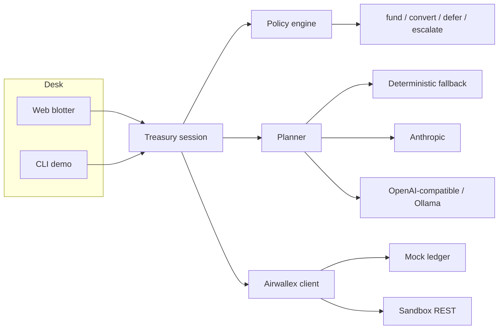

# Adaptive Treasury Controller

An agent that keeps multi-currency operating cash above a coded reserve floor while it settles a short book of invoices. **Airwallex is the payment rail** (Global Accounts, balances, FX, beneficiaries, and transfers). This repository is an independent hackathon project for Starter Kit 01 (Treasury & Ops). It is not an Airwallex product and there is no partnership.

The desk runs today with no API keys. When `AIRWALLEX_CLIENT_ID` and `AIRWALLEX_API_KEY` are set, the same flow calls the [Airwallex sandbox](https://api.sandbox.airwallex.com/api/v1).

## What the demo shows

Five obligations across USD, EUR, and GBP fall due inside 72 hours. The controller:

1. Funds a critical shipping invoice from USD.
2. Converts the minimum USD into EUR for a time-sensitive supplier, including the flat EUR 12.85 SWIFT fee.
3. Defers the cheapest non-critical obligation while the whole book cannot be paid.
4. Escalates a metals invoice that would break the reserve floor.
5. Lowers forecast confidence when a customer email contradicts an expected receipt, and asks a person to approve the same EUR conversion.
6. After a simulated inbound deposit, recalculates and changes only the decision the new cash unlocks.
7. Books one single-use FX quote, one conversion, and one supplier transfer, then shows that USD available is still above the floor.

Policy (the floor, the confidence gate, the fee, and the approval band) lives in `src/policy/engine.ts`. A model may explain the plan. It cannot change an action. With no model key, a deterministic planner supplies the explanations and the demo still runs.

## Architecture



The session calls the banking client, then asks the planner for explanations, then keeps the coded action when they disagree. Idempotent `request_id` values are reused only for a retry of the same global-account create, conversion, or transfer.

## Setup

Requires Node.js 22 or newer.

1. Sign up at [sandbox.airwallex.com](https://sandbox.airwallex.com). A personal email is fine. If you add another business, name it `New Business Sandbox` or `Sandbox Business` so sandbox onboarding can complete.
2. In the sandbox web app open **Account → Developer → API keys** and create a key. For this demo, give it read and write access and leave the IP allowlist empty.
3. Install and configure:

```sh
npm install
cp .env.example .env
```

Leave the key fields empty to stay in mock mode. Put the sandbox client id and API key only in `.env`. That file is gitignored. `.env.example` lists every variable and has no secrets.

| Variable | Purpose |
| --- | --- |
| `AIRWALLEX_CLIENT_ID` | Sandbox client id. Empty means mock mode when `TREASURY_MODE=auto`. |
| `AIRWALLEX_API_KEY` | Sandbox API key. Same rule. |
| `AIRWALLEX_BASE_URL` | Defaults to `https://api.sandbox.airwallex.com`. |
| `TREASURY_MODE` | `auto` (default), `mock`, or `sandbox`. |
| `LLM_PROVIDER` | `auto`, `anthropic`, `openai`, or `none`. |
| `ANTHROPIC_API_KEY` / `ANTHROPIC_MODEL` | Optional Claude explanations. |
| `OPENAI_BASE_URL` / `OPENAI_API_KEY` / `OPENAI_MODEL` | Optional OpenAI-compatible server. For Ollama: `http://127.0.0.1:11434/v1`, key `ollama`, model `llama3.1`. |
| `PORT` | Desk port, default `4317`. |

`x-api-version` is not sent. FX calls reject a stale version header, so the client leaves it off every request.

## Run it

Mock, one shot, including a recorded approval:

```sh
npm run demo
```

The same path pauses for `y` before the conversion:

```sh
npm run demo:interactive
```

Web desk:

```sh
npm run serve
```

Open `http://localhost:4317` and press the acts in order. **Reset desk** clears the mock ledger. It does not reverse a sandbox deposit.

Sandbox: set both Airwallex variables in `.env` (or export them) and leave `TREASURY_MODE=auto`. `npm run demo` and the desk then call the sandbox. Force the mock ledger even when keys are present with `TREASURY_MODE=mock`.

The scripted shortfall assumes about **USD 15,500** available before the later USD 2,500 receipt. Setup tops a poorer wallet up to that opening target. It does not withdraw a richer wallet. If your sandbox balance is already much higher, the floor may not bind and the desk says so. Policy still uses the live balances.

```sh
npm test
npm run typecheck
```

## Demo script for a video under five minutes

Record the web desk in mock mode, or in sandbox if the wallet is near the opening target. Say what the numbers are; don't only read the chat.

| Time | Act | On screen | Say |
| --- | --- | --- | --- |
| 0:00 | Title | Mode badge says Mock ledger or Airwallex sandbox. Five unpaid rows. Floor is USD 8,000. | This is an operating-cash controller. Airwallex is the rail. The reserve floor is code, not a prompt. |
| 0:25 | 1 · Fund | USD available becomes 15,500. Deposit status can read PENDING while the balance is already there. | Fund the USD global account, then read balances before any decision. |
| 0:50 | 2 · Plan | Ship: fund. Rheinwerk: convert, no approval. Mesa: defer. Dockside: defer, cheapest. Nordhalle: escalate. Policy panel shows headroom, cap, and the EUR 12.85 fee. | Critical freight is funded. The EUR supplier gets the minimum conversion, fee included. The cheapest retainer waits. The metals invoice would break the floor, so it is escalated. |
| 1:35 | 3 · Shock | The Cedar & Co. email appears. Confidence falls from 0.88 to 0.42. Rheinwerk flips to "Needs approval". Its action stays convert. | The email contradicts the USD 6,000 forecast. The gate drops the autonomous FX cap from 4,000 to 1,000, so this conversion now needs a person. |
| 2:15 | 4 · Recalc | USD 2,500 lands. Only Mesa Packaging changes, from defer to fund. Dockside and Nordhalle stay put. | New cash. Recalculate the affected row only. |
| 2:45 | Approve | The card names Rheinwerk, the EUR buy amount including the fee, and the estimated USD sell. Press **Approve this conversion**. | Approval is bound to that payee and those amounts. |
| 3:10 | 5 · Execute | Quote usage SINGLE_USE, conversion SETTLED, transfer PAID, USD still above 8,000. EUR is back to zero because the fee was in the buy amount. USD freight stays queued. | One quote, booked once. One supplier payout. The reserve floor still holds. |
| 4:10 | Audit | Scroll the log: schema path, request ids, policy overrides if a model disagreed. | The model can explain. It cannot move the money. |
| 4:30 | Close | `.env.example` in the repo, keys not in git. | Sandbox keys stay local. This is a hackathon demo, not a partnership and not live money. |

Skip any peer-session or chain handshake. It is not the payment rail and it is not in this build.

## Sandbox calls

Base URL `https://api.sandbox.airwallex.com/api/v1`. Amounts are major units.

| Step | Call |
| --- | --- |
| Auth | `POST /authentication/login` with `x-client-id` and `x-api-key`. Cache `token` until `expires_at`. |
| Accounts | `GET /global_accounts`. `POST /global_accounts/create` only when no USD local account exists. |
| Funding | `POST /simulation/deposit/create` with `global_account_id` and `amount`. No `currency` field. Re-read `GET /balances/current`. |
| Rates | `GET /fx/rates/current` for an indicative rate. |
| Quote | `POST /fx/quotes/create` with `buy_currency`, `sell_currency`, `buy_amount`, and `validity`. Read `client_rate`, `sell_amount`, `quote_id`, and `usage`. |
| Conversion | `POST /fx/conversions/create` with `request_id`, currencies, `buy_amount`, and `quote_id`. |
| Beneficiary | Schema, then `POST /beneficiaries/create`, then `POST /transfers/create`. |
| Terminal status | `POST /simulation/transfers/{id}/transition` through SENT before PAID. |

The EUR beneficiary in the seed uses a well-known test IBAN and BIC with a synthetic company name. Sandbox validates the IBAN checksum. It is not a customer account.

## Doc ambiguities

Checked against the [hackathon builder guide](https://airwallexdev.com/guide), the public API reference, and the docs MCP at `https://mcp.sandbox.airwallex.com/docs`. No official Kit 01 source repository was found under an Airwallex organization; the guide is the kit. A community multi-kit desk exists elsewhere and was not used as the code base.

- The guide calls the schema endpoint `POST /beneficiaries/schema`. The API reference calls it `POST /beneficiary_api_schemas/generate`. The client tries the guide path and, on 404 or `not_found`, uses the documented path. The audit records which one answered. **Not verified against a live sandbox in this run** (no keys).
- One FX guide example posts to `/api/v1/conversions/create`. The endpoint heading and the kit both say `POST /fx/conversions/create`. This client uses the `/fx/` path.
- Quote create has **no** `request_id`. The reference shows `usage: SINGLE_USE`. Idempotency for the booking is the conversion `request_id`. The kit text says to book a quote once with one request id; that id is on the conversion, not the quote. The conversion reference also says a reused `request_id` is rejected, while the kit says to reuse a `request_id` when retrying the same operation. The mock returns the original conversion for the same id and body. A live `duplicate_request_id` stops the desk instead of minting a second id.
- `GET /fx/rates/current` describes top-level `rate` in one place like a sell amount. The kit says to read `rate` as the indicative rate, and to read `client_rate` on a quote. The client prefers `rate_details` where `level` is `CLIENT`, then a top-level `rate` that looks like a price rather than a notional. The booked quote's `sell_amount` is what the floor check uses.
- A simulated deposit can return `PENDING` while the balance is already spendable. The session re-reads balances before it replans.
- The flat EUR 12.85 SWIFT fee is the kit's observed sandbox fee, not a fee-quote API. It is added to the EUR buy amount. Local payouts add nothing. On a live transfer, `fee_amount` in the create response is the number that posted.
- `x-api-version` is omitted. The kit says a stale value returns `incorrect_version` on FX, and that PAID simulation wants a recent version. If a sandbox transition to PAID fails for version reasons, that still needs a keyed check.
- Global-account list pagination fields were not fully specified in the retrieved pages. The client reads the first page (`items`, or a bare array). A normal sandbox account fits on one page.
- Transfer `request_id` length is described as 10–50 characters in the sandbox constraints and as up to 50 in one reference page. A UUID fits both.

## Layout

```
src/policy/engine.ts          reserve floor, confidence gate, fee, cheapest-defer rule
src/planner/planner.ts        Anthropic, OpenAI-compatible, deterministic fallback
src/airwallex/http-client.ts  sandbox REST and token cache
src/airwallex/mock-client.ts  same interface, no network
src/treasury/session.ts       the six acts
src/cli.ts                    demo and web server
public/                       judge-facing desk
tests/                        policy, mock flow, client shape
```

## License

MIT. Copyright 2026 Hobie Cunningham.
